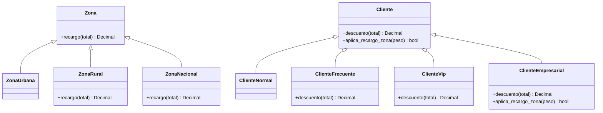

# Parte 6 · Refactorización

Estudiante: Martín Alejandro Solano Finol · Código: 0182410126

## 1. Punto de partida

- Rama de trabajo: `refactor/estrategia`, creada desde `test/suite`.
- Código heredado: `v1.0.0`, conservado en la etiqueta y en `main`.
- Suite: 43 casos CN/CB en `tests/test_envios.py`.
- Estado inicial: 16 fallos, 100 % de cobertura de sentencias y 100 % de ramas.

No cambié los resultados esperados. Solo cambié la forma de calcular y las entradas de CB-15 y CB-16, porque eliminé el argumento `flag`.

## 2. Code smells identificados

| # | Code smell | Línea (v1.0.0) | Deuda técnica | Cómo lo corregí |
|---|---|---|---|---|
| 1 | Nombres crípticos | 12: `calc(p, z, c, d, cup)`; `t` en todo el cuerpo | No se entiende qué representa cada dato | Usé `peso`, `zona`, `cliente`, `dia`, `cupon` y `total` en las variables internas; la firma pública se mantiene por compatibilidad |
| 2 | Números mágicos | 16, 18, 20, 24, 26, 31, 33, 36, 37, 41 | Cambiar una tarifa obliga a buscar números por todo el código | Creé constantes con nombre |
| 3 | Función larga | 12-41 | Hacía validación, tarifa, recargos, descuentos, mínimo, redondeo y salida | Dividí el cálculo en funciones pequeñas |
| 4 | Flag argument y salida por consola | 12 (`flag=False`), 39-40 (`print`) | Mezclaba el cálculo con la presentación y agregaba una rama artificial | Eliminé `flag` y el `print` |
| 5 | Código muerto | 21-22 (`if z == "urbana": t = t`) | No hacía nada y confundía | La estrategia `ZonaUrbana` usa el recargo por defecto |
| 6 | Condicionales duplicados | 21-26 (zona), 30-33 (cliente) | Agregar una zona o un cliente obligaba a tocar varios `if` | Usé el patrón Estrategia para zona y cliente |
| 7 | `float` para dinero | 24, 26, 31, 33, 36, 41 | Los decimales binarios y el truncado producían errores de redondeo | Usé `Decimal` y `ROUND_HALF_UP` |
| 8 | Configuración global mutable | 2-9 (`CONFIG`) | Cualquier módulo podía cambiar las tarifas en tiempo de ejecución | Reemplacé `CONFIG` por constantes inmutables |

La firma pública se mantiene `calc(p, z, c, d, cup=None)` para no romper las llamadas existentes; los nombres descriptivos se usan dentro de `calc` y en las funciones auxiliares.

También había validación incompleta: no se revisaba la zona ni el día. Eso quedó registrado como DEF-03 y DEF-04.

## 3. Defectos corregidos

| Defecto | Cambio aplicado | Casos que lo verifican |
|---|---|---|
| DEF-01 | `_tarifa_base` usa `peso < LIMITE_TRAMO_1` | CN-10, CN-26 |
| DEF-02 | `_recargo_finde` usa `dia >= DIA_SABADO` | CN-17, CN-19 |
| DEF-03 | `_validar_zona` lanza `ValueError("zona inválida")` | CN-05, CB-08 |
| DEF-04 | `_validar_dia` lanza `ValueError("día inválido")` | CN-06, CN-07 |
| DEF-05 | `_redondear` usa `Decimal` y `ROUND_HALF_UP` | CN-12, CN-19, CN-21, CN-25, CN-26 |
| DEF-06 | `_validar_peso` lanza `ValueError("peso inválido")` | CN-01, CN-02, CN-03, CB-02, CB-03 |

### Clasificación de los cambios

| Cambio | Tipo | Justificación |
|---|---|---|
| Correcciones DEF-01 a DEF-06 | Correctivo | Eliminan fallos contra la especificación. |
| Suite de 43 casos y referencia con `Decimal` | Preventivo | Detectan regresiones y validan los resultados esperados. |
| Funciones pequeñas, constantes, Estrategia y `Decimal` | Perfectivo | Mejoran la estructura y la mantenibilidad sin cambiar la funcionalidad esperada. |
| Eliminación de `flag` y `print` | Perfectivo | Separan el cálculo de la presentación y reducen ramas artificiales. |
| Cliente empresarial de la Parte 8 | Perfectivo | Agrega funcionalidad nueva y mejora la utilidad del sistema. |
| Cambios adaptativos | Ninguno | No cambió el entorno ni una dependencia externa. |

## 4. Diseño de la refactorización

Separé el cálculo en estas partes:

- Constantes: tarifas, límites, recargos, descuentos, mínimo y unidad de redondeo.
- `_validar_peso`, `_validar_zona` y `_validar_dia`: revisan el contrato de entrada.
- `_tarifa_base`: calcula el tramo por peso.
- `Zona`, `ZonaUrbana`, `ZonaRural` y `ZonaNacional`: aplican el recargo de zona con Estrategia.
- `Cliente`, `ClienteNormal`, `ClienteFrecuente` y `ClienteVip`: aplican el descuento con Estrategia.
- `_recargo_finde`: suma el recargo de sábado y domingo antes de los descuentos.
- `_descuento_cupon`: aplica ENVIO10 después del descuento del cliente.
- `_aplicar_minimo`: garantiza el mínimo de $5.000.
- `_redondear`: redondea al múltiplo de $100 más cercano con los $50 hacia arriba.
- `calc`: solo coordina las funciones anteriores.

La firma pública quedó así: `calc(p, z, c, d, cup=None)`. Ya no recibe `flag` y no imprime nada.

## 5. Patrón Estrategia

Usé una clase base para cada familia de reglas:

- `Zona.recargo(total)` devuelve el total sin cambios. `ZonaUrbana` hereda ese comportamiento.
- `ZonaRural` y `ZonaNacional` sobrescriben `recargo` con su porcentaje.
- `Cliente.descuento(total)` devuelve el total sin cambios. `ClienteNormal` hereda ese comportamiento.
- `ClienteFrecuente` y `ClienteVip` sobrescriben `descuento`.

Los diccionarios `ZONAS` y `CLIENTES` relacionan el texto de entrada con la estrategia. Así `calc` no necesita una cadena de `if/elif`. Para la Parte 8 solo tendré que agregar una estrategia nueva para el cliente empresarial.



El diagrama muestra el estado final; `ClienteEmpresarial` se agregó en la Parte 8.

## 6. Cambios en las pruebas

- CB-15 y CB-16 ya no pasan `flag=True`, porque el argumento se eliminó.
- Los resultados esperados de esos casos no cambiaron: $6.000 y $10.900.
- La implementación de referencia sigue verificando los 43 resultados documentados.
- La regresión completa queda en 86 pruebas aprobadas y 0 fallidas.

## 7. Métricas comparadas

| Métrica | Antes (`v1.0.0`) | Después (`refactor/estrategia`) |
|---|---|---|
| Complejidad máxima por función (radon) | 15 (C) | 3 (A) |
| Complejidad de `calc` | 15 (C) | 1 (A) |
| LOC | 41 | 139 |
| SLOC | 37 | 98 |
| LLOC | 31 | 90 |
| Comentarios | 2 | 0 |
| Sentencias cubiertas | 100 % (29 de 29) | 100 % (88 de 88) |
| Ramas cubiertas | 100 % (26 de 26) | 100 % (14 de 14) |
| Pruebas aprobadas | 70 de 86 | 86 de 86 |
| Pruebas fallidas | 16 | 0 |

Las líneas aumentaron porque ahora cada tarifa y cada estrategia tiene un nombre. La complejidad máxima bajó de 15 a 3 y la función principal quedó en 1. El código es más largo, pero cada parte hace una sola cosa.

## 8. Comandos de verificación

```powershell
python -m pytest tests -q
python -m pytest --cov=envios --cov-branch --cov-report=term-missing -q
python -m radon cc envios.py -s
python -m radon raw envios.py -s
```

Resultados:

- `pytest`: 86 aprobadas.
- Cobertura: 100 % de sentencias y 100 % de ramas.
- Radon: todas las funciones y clases en categoría A. La máxima complejidad es 3.

## 9. Decisiones y riesgos

- Acepté el aumento de líneas porque la complejidad máxima bajó y el código quedó más fácil de extender.
- Usar Estrategia agrega clases, pero elimina los `if/elif` de zona y cliente.
- Usar `Decimal` evita los errores de precisión del `float`.
- Eliminar `flag` es un cambio incompatible para quien llamara `calc(..., flag=True)`. En este proyecto solo lo usaban las pruebas y ya las actualicé. Por eso la Parte 7 justifica una versión mayor, `v2.0.0`.

## 10. Trazabilidad

| Requisito | Defecto | Corrección | Pruebas |
|---|---|---|---|
| R1 | DEF-06 | Mensaje con tilde | CN-01, CN-02, CN-03, CB-02, CB-03 |
| R2 | DEF-03, DEF-04 | Validación de zona y día | CN-05, CN-06, CN-07, CB-08 |
| R3 | DEF-01 | Límite del tramo 1 | CN-10, CN-26 |
| R4 | Ninguno | Estrategia de zona | CN-14, CN-15, CN-16, CB-06, CB-07 |
| R5 | DEF-02 | Recargo de sábado y domingo | CN-17, CN-18, CN-19, CN-25, CB-09 |
| R6 | Ninguno | Estrategia de cliente y cupón | CN-19, CN-20, CN-21, CN-22, CB-10, CB-11, CB-13 |
| R7 | Ninguno | Cupón inexistente se ignora | CN-23, CB-12 |
| R8 | DEF-05 | Redondeo con `ROUND_HALF_UP` | CN-12, CN-21, CN-24, CN-25, CN-26, CB-14 |

## 11. Para la sustentación

- Puedo explicar cada code smell con su línea y el cambio concreto que hice.
- Puedo mostrar que la complejidad máxima bajó de 15 a 3 con `radon`.
- Puedo explicar que las líneas subieron porque separé constantes y estrategias, pero la función principal quedó en complejidad 1.
- Puedo mostrar las 86 pruebas aprobadas y la cobertura del 100 %.
- Puedo explicar la diferencia entre cambios correctivos, perfectivos y preventivos.
- Puedo mostrar el diagrama UML del patrón Estrategia.

### Capturas para el PDF

- Tabla de code smells con las líneas de `v1.0.0`.
- Diagrama UML Mermaid renderizado.
- `git switch refactor/estrategia` y `python -m pytest -q` con 86 pruebas aprobadas.
- `python -m radon cc envios.py -s` antes y después.
- `python -m pytest --cov=envios --cov-branch --cov-report=term-missing -q` con 100 % de cobertura.

## 12. Nota de cierre (Parte 8)

La Parte 8 agregó `ClienteEmpresarial` y la regla de zona para pesos mayores a 10 kg. Las métricas de la sección 7 son las de la Parte 6. El estado final de `v2.1.0` es: 98 pruebas aprobadas, 100 % de cobertura (97 sentencias y 16 ramas), complejidad máxima 3, `calc` con complejidad 2, LOC 153 y SLOC 108. Ver `08-cliente-empresarial.md`.
